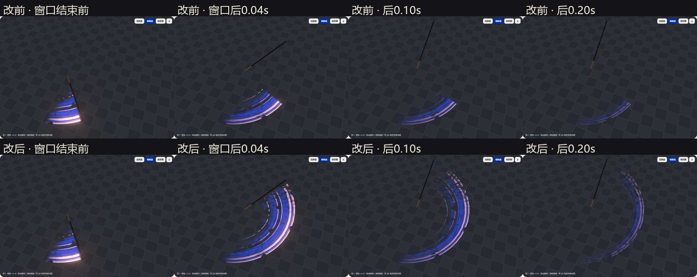
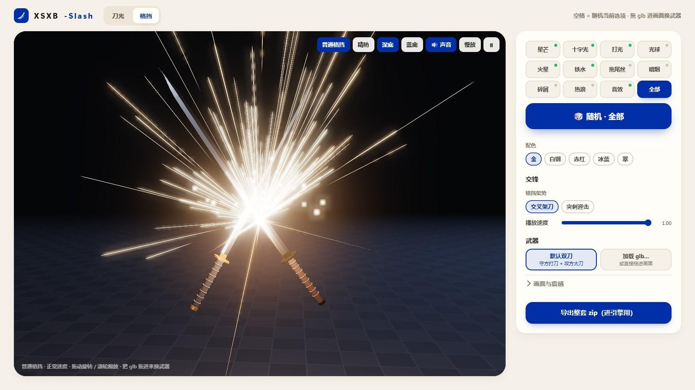
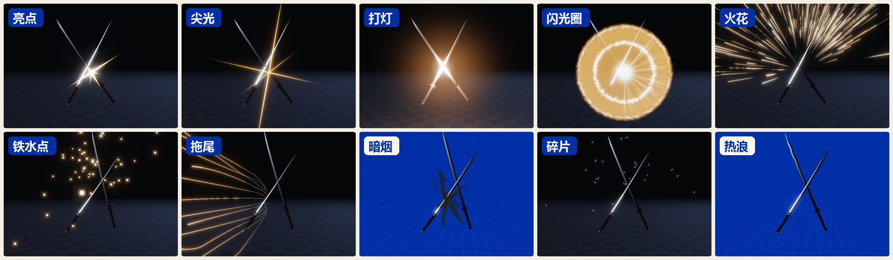
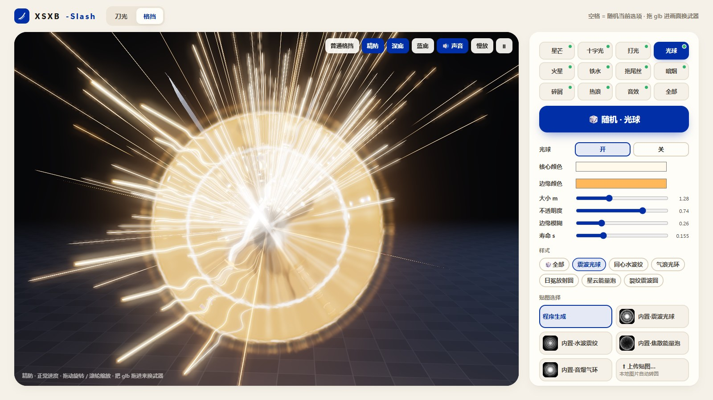
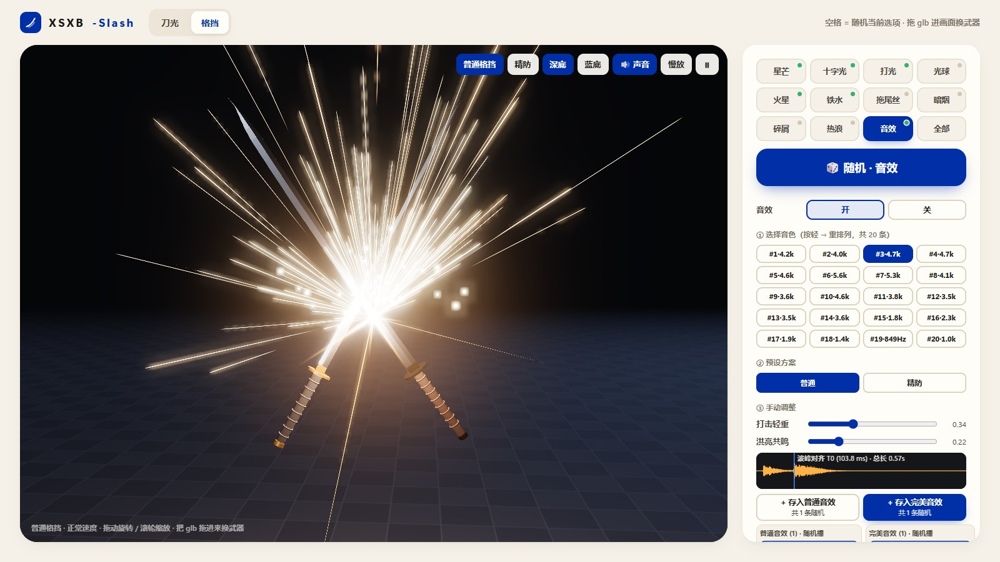

**中文** | [English](README_en.md)

在浏览器里做游戏**刀光**和**格挡特效 + 音效**：一键随机、叠层、3D 实时预览，再导出一个包，放进 Unity、Godot 或 Unreal。

*上面是演示视频里的一小段（连按 🎲 随机）。完整视频：[xsxb-slash-demo.mp4](docs/media/xsxb-slash-demo.mp4)*

## 刀光

**样式**：每一项都有好几种生成算法，🎲 会在里面随机；也可以在「详细」里锁定一种。
- 主体 / 高光：默认、细密丝、粗团块、短尾、均匀条、云团、月牙、碎羽、火舌、刷痕、双层（高光另有双线、断续、月牙光等）。
- 溶解 / 啃咬 / 折射贴图：云雾、裂纹、风丝、墨迹、烧蚀、干笔、孔洞、碎块、水纹、电纹、纸纹、像素、波浪、鳞片。
- 折射：波纹、一圈一圈、水波纹、水波+波纹。
- 火星：爆散、上飘余烬、星点闪烁；烟雾：升腾、贴地、拖尾细烟；液体：顺刀甩出、滴落、雾沫。

### 收尾：攻击窗口结束后怎么收（2026-11-25 新）

以前攻击窗口一结束，刀光靠武器那一端会留下一条整齐的直切口，一直留到刀光消失。现在「收尾」面板有三项，各自可开关、可调：

- **延尾淡出**：窗口关了以后，刀光再跟着武器走一小段（默认 0.08 s），这段逐渐变透明。伤害判定不变。
- **头部切口**：这一刀停止生长后，靠武器那段（默认 0.22 m）变成不规则、局部模糊、变淡的边。宽度不变。
- **溶解收尾**：消失阶段用溶解图的噪声侵蚀。

导出的 recipe.json 多了 `finish`，三个引擎的参考代码都已支持（公式见 [docs/SPEC.md](docs/SPEC.md) 4c）。没有 `finish` 的旧配方保持原样。

## 格挡（新）

点顶部 **格挡** 标签：两把刀交击（蓄力 → 咬合顿帧 → 刀身震颤 → 弹开），分 **普通格挡** 和 **精防** 两档。🎲 随机会一次生成两档（精防比普通更猛）；手动改参数只改当前这一档。

一次格挡由十层叠出来，每层都能单独开关、单独随机：

| 层 | 做什么 |
|---|---|
| 亮点 | 交击点上的白热星芒，压在一切之上 |
| 尖光 | 几根又细又长的锐光，一闪即逝 |
| 打灯 | 一盏瞬间点亮的点光源，照亮刀身和地面 |
| 闪光圈 | 圆形冲击光球 / 水波 / 光环等 6 种程序化样式，另有内置贴图，也能上传自己的图 |
| 火花 | 高速爆散的火星，带落地弹跳；初速可调 |
| 铁水点 | 慢一点、会冷却变暗的铁水颗粒 |
| 拖尾 | 发光的拖尾丝，6 种飞法；默认沿防守方身前的隐形球面平滑滑走 |
| 暗烟 | 半透明墨色暗烟，在交击点原地扩散，给亮光做反衬 |
| 碎片 | 旋转弹跳的金属碎屑 |
| 热浪 | 整个画面的水波纹扭曲（后处理，不上色） |

**音效**：内置 20 条打铁音色（轻脆 → 沉重）。三个推子：音色、打击轻重、共鸣。声音的波峰对齐交击那一帧。普通格挡和精防各存一套，导出成 WAV。

## 怎么用

1. 下载本仓库，用浏览器打开 `index.html`。不用安装；3D 预览从 CDN 加载 three.js，需要联网。
2. 选 **刀光** 或 **格挡**，右侧选一项（或「全部」），点 **🎲 随机** 或按 **空格**。不满意就再按；「最近几次」里点一下能换回去。
3. 想换武器：点 **加载 glb…**，或者直接把 `.glb` 拖进画面。
4. 满意了点 **导出整套 zip（进引擎用）**。

导出包：
- 刀光（例子 [examples/fable](examples/fable)）：`recipe.json` + `textures/{shape,mask,highlight}.png` + `preview.png`
- 格挡（例子 [examples/parry_fable](examples/parry_fable)）：`recipe.json`（两档 `normal` / `perfect`）+ `textures/*.png` + `audio/parry_{normal,perfect}.wav` + `preview.png`

## 放进游戏引擎

- **手动：** 按 [skill/xsxb-slash-install/SKILL.md](skill/xsxb-slash-install/SKILL.md) 的步骤做（Unity、Godot 4、Unreal 5 都有，刀光和格挡都有）。
- **让 AI 编程助手装：** 把 `skill/xsxb-slash-install` 交给它（Claude Code：复制到项目的 `.claude/skills/`），再给它导出包，说「把这个刀光装到我的剑上」或「把这个格挡特效和音效装进项目」。以后换效果只换导出文件，不改代码。

| 目录 | 内容 |
|---|---|
| `docs/SPEC.md` | 刀光规格：条带 UV、着色器公式、单位、自检方法 |
| `docs/SPEC_PARRY.md` | 格挡规格：两档、各层参数、音效波峰对齐 |
| `docs/PARRY_MIGRATION_*.md` | 格挡包旧版本 → 新版本的改动说明 |
| `engines/unity/` | 刀光 `XsxbSlashTrail` + 格挡 `XsxbParryBurst`（Built-in / URP） |
| `engines/godot/` | 刀光 `xsxb_slash_trail.gd` + 格挡 `XsxbParryBurst.gd`（Godot 4） |
| `engines/unreal/` | 刀光 `XsxbSlashTrailComponent` + 格挡 `XsxbParryBurstComponent`（UE5 C++） |
| `skill/xsxb-slash-install/` | AI 助手用的安装说明 |

## 说明

- 贴图都由工具自己生成或 AI 生成，不取自任何游戏。`assets/smoke_sheet_2048.png`（烟雾序列帧，作者自制）可随意使用；`assets/smoke_sheet.js` 是同一张图，内嵌后可以直接用 `file://` 打开页面。
- 格挡的内置贴图（`assets/parry/builtin_src/`）是 AI 生成的；音效是作者用 AI 生成的，可随意使用。
- 刀光的折射、火星、液体、烟雾等在网页里是预览效果，recipe 会记下参数（见 `docs/SPEC.md` 4b），引擎端只画刀光条带。格挡各层在引擎端怎么实现见 `docs/SPEC_PARRY.md`。

## 许可

[MIT](LICENSE)
