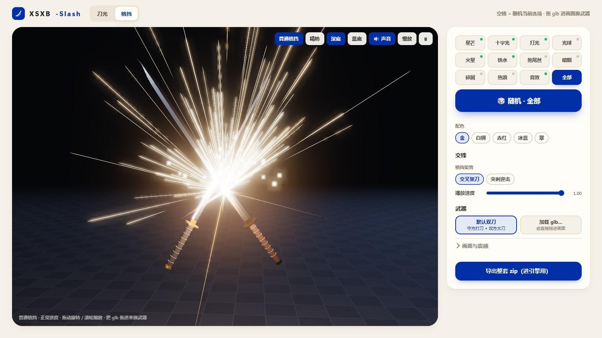
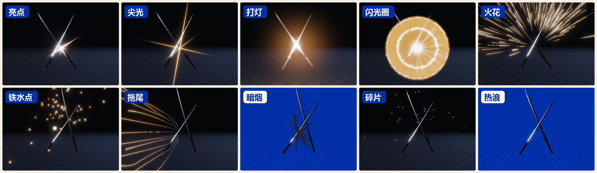
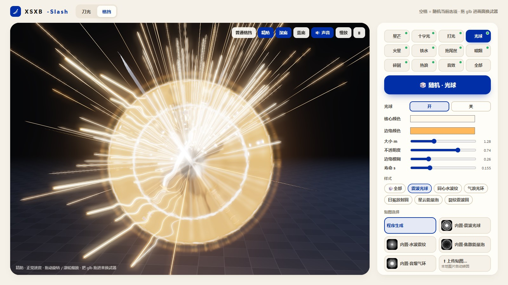
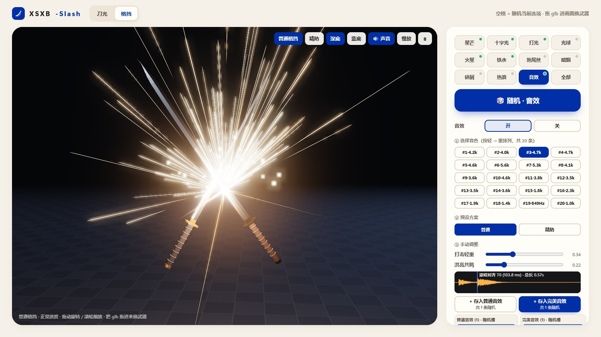

[中文](README.md) | **English**

Make game **slash trails** and **parry VFX + SFX** in the browser: roll random styles, stack layers, preview in 3D, then export a bundle for Unity, Godot or Unreal.

*A short cut from the demo video (pressing 🎲 again and again). Full video: [xsxb-slash-demo.mp4](docs/media/xsxb-slash-demo.mp4).*

## Slash trails

**Styles**: every item has several generators; 🎲 picks among them, or lock one under "详细" (details).
- Body / highlight: default, fine threads, blobs, short tail, even strip, clouds, crescent, feathers, flame tongue, brush, double layer (highlights also: double line, broken, crescent glow…).
- Dissolve / gnaw / refraction maps: clouds, cracks, wind threads, ink, burn, dry brush, holes, chunks, water, lightning, paper, pixel, waves, scales.
- Refraction: ripple, rings, water ripple, water + ripple.
- Sparks: burst, rising embers, twinkle; smoke: rise, ground, thin trail; liquid: flung off the blade, drip, mist.

## Parry (new)

Open the **格挡 (Parry)** tab: two blades clash (wind-up → bite + hit-stop → blade tremor → bounce off), in two tiers, **normal parry** and **perfect parry**. 🎲 rolls both tiers at once (perfect is stronger); manual edits change only the current tier.

One parry is ten layers, each with its own on/off and its own 🎲:

| Layer | What it does |
|---|---|
| Hot spot (`star`) | White-hot star at the contact point, drawn on top of everything |
| Glints (`needles`) | A few long, thin streaks that flash and vanish |
| Light (`light`) | A point light that flicks on and lights the blades and floor |
| Flash ring (`flash`) | Round shock flash: 6 procedural styles (sphere, ripple, halo…), built-in masks, or upload your own |
| Sparks (`sparks`) | Fast spark burst with floor bounces; launch speed adjustable |
| Molten drops (`ember`) | Slower molten-iron specks that cool and darken |
| Ribbons (`ribbon`) | Glowing streaks, 6 flight styles; by default they glide smoothly off an invisible sphere in front of the defender |
| Dark smoke (`smoke`) | Translucent ink smoke spreading in place at the contact, to set off the bright layers |
| Debris (`debris`) | Spinning, bouncing metal chips |
| Heat wave (`refr`) | Full-frame water-ripple distortion (post-process, adds no colour) |

**Sound**: 20 built-in clash sounds (light → heavy). Three sliders: timbre, impact weight, ring. The sound's peak lands on the contact frame. Normal and perfect each keep their own setting and export as WAV.

## How to use

1. Download this repo and open `index.html` in a browser. Nothing to install; the 3D preview loads three.js from a CDN, so you need to be online.
2. Pick **刀光 (Slash)** or **格挡 (Parry)**, choose an item on the right (or "全部" = all), press **🎲** or **Space**. Not happy? Press again; click a thumbnail under "最近几次" to go back.
3. Other weapon: **加载 glb…** or drag a `.glb` onto the view.
4. Click **导出整套 zip** (export bundle).

Bundles:
- Slash (example [examples/fable](examples/fable)): `recipe.json` + `textures/{shape,mask,highlight}.png` + `preview.png`
- Parry (example [examples/parry_fable](examples/parry_fable)): `recipe.json` (tiers `normal` / `perfect`) + `textures/*.png` + `audio/parry_{normal,perfect}.wav` + `preview.png`

## Into a game engine

- **By hand:** follow [skill/xsxb-slash-install/SKILL.md](skill/xsxb-slash-install/SKILL.md) (Unity, Godot 4, Unreal 5; slash and parry).
- **With a coding agent:** give it `skill/xsxb-slash-install` (Claude Code: copy into the project's `.claude/skills/`) and the bundle, and say "put this trail on my sword" or "install this parry VFX and sound". Later, swapping effects only swaps the exported files.

| Folder | What |
|---|---|
| `docs/SPEC.md` | Slash contract: strip UVs, shader formula, units, self-check |
| `docs/SPEC_PARRY.md` | Parry contract: tiers, layer parameters, peak-synced sound |
| `docs/PARRY_MIGRATION_*.md` | What changed between parry bundle versions (Chinese) |
| `engines/unity/` | Slash `XsxbSlashTrail` + parry `XsxbParryBurst` (Built-in / URP) |
| `engines/godot/` | Slash `xsxb_slash_trail.gd` + parry `XsxbParryBurst.gd` (Godot 4) |
| `engines/unreal/` | Slash `XsxbSlashTrailComponent` + parry `XsxbParryBurstComponent` (UE5 C++) |
| `skill/xsxb-slash-install/` | Install guide for coding agents |

## Notes

- All textures are generated by the tool or by AI; nothing is taken from any game. `assets/smoke_sheet_2048.png` (smoke flipbook, made by the author) is free to use; `assets/smoke_sheet.js` is the same image embedded so the page also works from `file://`.
- The parry built-in textures (`assets/parry/builtin_src/`) are AI-generated; the sounds were made by the author with AI and are free to use.
- For slash trails, refraction / sparks / liquid / smoke are preview effects in the page; the recipe stores their parameters (`docs/SPEC.md` 4b) and the engine code draws the trail strip only. For how each parry layer is implemented in engines, see `docs/SPEC_PARRY.md`.

## License

[MIT](LICENSE)
